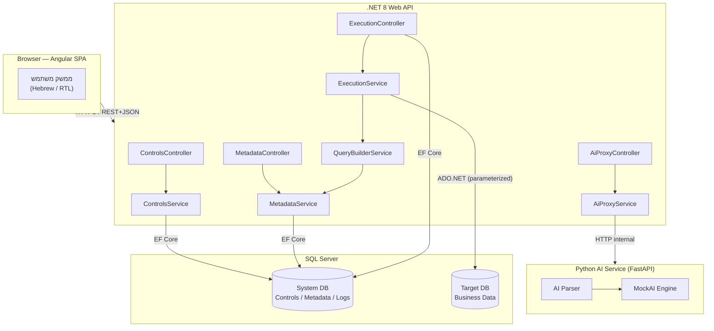
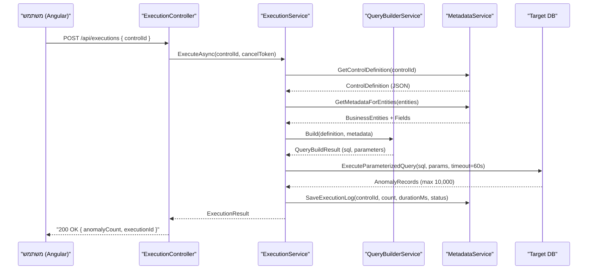
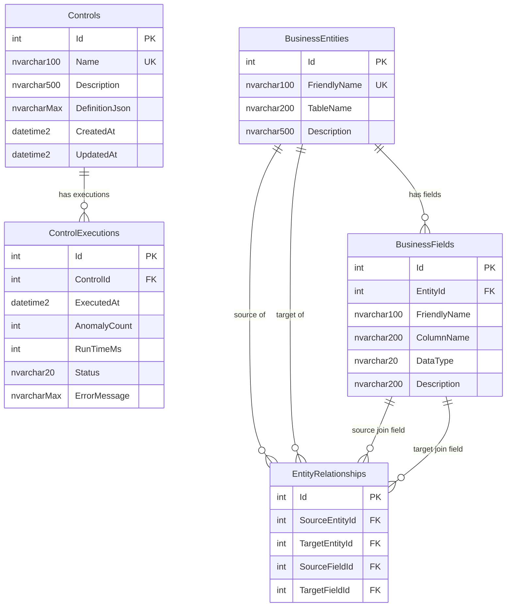
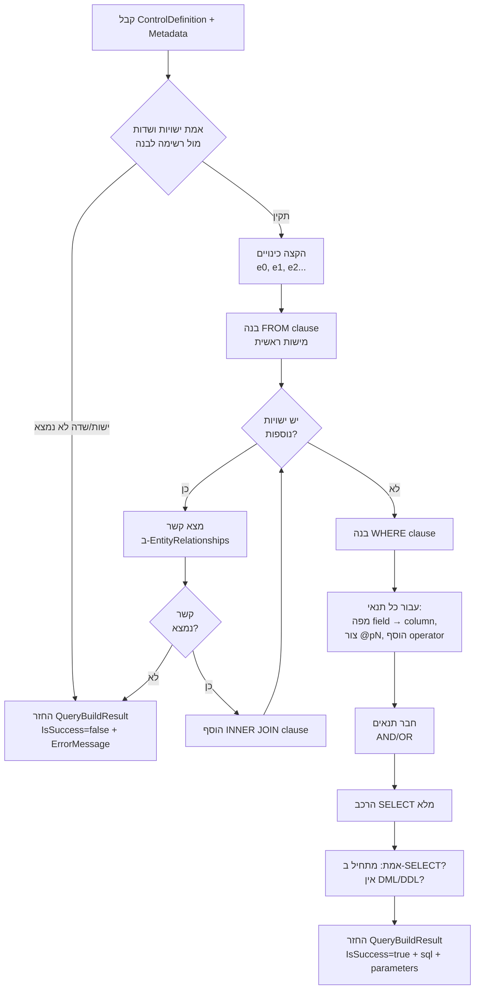
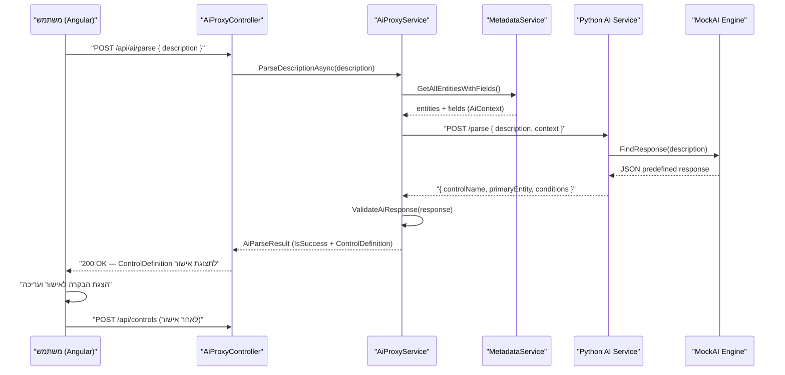

# מסמך תכנון - Dynamic Data Controls

## Overview

מערכת **Dynamic Data Controls** היא אפליקציית Web גנרית לניהול, הגדרה והרצה של בקרות איכות נתונים. המערכת מאפשרת למשתמשים עסקיים להגדיר כללים לאיתור חריגות, שגיאות וחוסר עקביות בנתונים – ללא ידע ב-SQL ומבנה הטבלאות הטכני.

### שלבי הפיתוח

| שלב | תיאור |
|-----|--------|
| **שלב א'** | ממשק הגדרת בקרות ידנית עם בונה תנאים ויזואלי, יצירת SQL דינאמי, הרצת בקרות וצפייה בתוצאות |
| **שלב ב'** | תשתית AI: תיאור בקרה בשפה חופשית (עברית), תרגום ל-JSON מובנה על-ידי מנתח AI (MockAI בשלב הנוכחי) |

### מחסנית טכנולוגית

| שכבה | טכנולוגיה |
|------|-----------|
| Frontend | Angular 17+ עם RTL/עברית |
| Backend | .NET 8 Web API (C#) |
| AI Service | Python 3.11+ (FastAPI) |
| Database | SQL Server 2019+ |
| ORM | Entity Framework Core 8 (System DB), ADO.NET (Target DB) |
| Authentication | JWT Bearer Tokens |
| PBT (.NET) | FsCheck 3 |
| PBT (Python) | Hypothesis |
| PBT (Angular) | fast-check |

---

## Architecture

### ארכיטקטורה כללית (High-Level)

המערכת בנויה בארכיטקטורת **שלוש שכבות** עם מיקרו-שירות Python נפרד עבור רכיב ה-AI.



### עקרונות ארכיטקטורה

1. **הפרדת שכבות** – כל שכבה (UI / API / AI / DB) ניתנת להחלפה בלי לשנות את השכבות האחרות.
2. **ממשקים גנריים** – `QueryBuilderService` חשוף דרך `IQueryBuilderService`; ניתן להחליף את מנוע ה-SQL בלי לשנות את ה-API החיצוני.
3. **כתיבה מאובטחת** – SQL נוצר אך ורק ב-`QueryBuilderService`; Parameterized Queries; SELECT-only.
4. **AI כשירות חיצוני** – `AiProxyService` מנהל את התקשורת ב-.NET; שירות Python מכיל רק את לוגיקת ה-AI.
5. **RTL ועברית** – כל הממשק ב-Angular מוגדר עם `dir="rtl"` ו-`lang="he"` ברמת ה-AppModule.

### תרשים רצף – הרצת בקרה



---

## Components and Interfaces

### Frontend — Angular

#### מבנה מודולים

```
src/
├── app/
│   ├── core/
│   │   ├── services/
│   │   │   ├── controls.service.ts
│   │   │   ├── metadata.service.ts
│   │   │   ├── execution.service.ts
│   │   │   ├── ai.service.ts
│   │   │   └── notification.service.ts
│   │   ├── guards/
│   │   │   └── admin.guard.ts
│   │   └── interceptors/
│   │       ├── auth.interceptor.ts
│   │       └── error.interceptor.ts
│   ├── features/
│   │   ├── controls/
│   │   │   ├── controls-list/        # רשימת בקרות
│   │   │   ├── control-form/         # טופס יצירה/עריכה
│   │   │   └── control-execution/    # הרצה + תוצאות
│   │   ├── ai-interface/             # ממשק AI
│   │   └── metadata-admin/           # ניהול מטא-נתונים (admin only)
│   └── shared/
│       ├── components/
│       │   ├── condition-builder/    # בונה תנאים ויזואלי
│       │   ├── results-table/        # טבלת תוצאות חריגות
│       │   ├── loading-spinner/
│       │   └── error-banner/
│       └── models/                   # TypeScript interfaces
```

#### רכיבי Angular (Components)

| רכיב | תיאור | Inputs / Outputs עיקריים |
|------|--------|--------------------------|
| `ControlsListComponent` | רשימת בקרות עם חיפוש (debounce 300ms), מיון ופעולות | — |
| `ControlFormComponent` | טופס יצירה/עריכה עם validation | `controlId?: number` |
| `ConditionBuilderComponent` | בונה תנאים ויזואלי; בחירה מרשימות בלבד | `@Input definition`, `@Output definitionChange` |
| `ControlExecutionComponent` | כפתור הרצה, spinner, ספירת חריגות | `controlId: number` |
| `ResultsTableComponent` | טבלה עם מיון/חיפוש/pagination/CSV export | `@Input results`, `@Input columns` |
| `AiInterfaceComponent` | שדה טקסט חופשי + תצוגת בקרה שנוצרה לאישור | — |
| `MetadataAdminComponent` | ניהול ישויות, שדות וקשרים (admin) | — |

#### Angular Services (Core)

| שירות | תיאור |
|--------|--------|
| `ControlsService` | CRUD עבור בקרות — `GET/POST/PUT/DELETE /api/controls` |
| `MetadataService` | ישויות, שדות וקשרים — `/api/metadata` |
| `ExecutionService` | הרצה, ביטול, שליפת תוצאות — `/api/executions` |
| `AiService` | ניתוח תיאור חופשי — `POST /api/ai/parse` |
| `NotificationService` | הצגת הודעות שגיאה/הצלחה (toast) בעברית |

#### Routing

```typescript
const routes: Routes = [
  { path: '',              redirectTo: '/controls', pathMatch: 'full' },
  { path: 'controls',      component: ControlsListComponent },
  { path: 'controls/new',  component: ControlFormComponent },
  { path: 'controls/:id/edit', component: ControlFormComponent },
  { path: 'controls/:id/run',  component: ControlExecutionComponent },
  { path: 'ai',            component: AiInterfaceComponent },
  { path: 'admin/metadata', component: MetadataAdminComponent,
    canActivate: [AdminGuard] }
];
```

---

### Backend — .NET 8 Web API

#### מבנה הפרויקט

```
DynamicDataControls.Api/
├── Controllers/
│   ├── ControlsController.cs
│   ├── MetadataController.cs
│   ├── ExecutionController.cs
│   └── AiProxyController.cs
├── Services/
│   ├── Interfaces/
│   │   ├── IControlsService.cs
│   │   ├── IMetadataService.cs
│   │   ├── IQueryBuilderService.cs   ← ניתן להחלפה
│   │   ├── IExecutionService.cs
│   │   └── IAiProxyService.cs
│   ├── ControlsService.cs
│   ├── MetadataService.cs
│   ├── QueryBuilderService.cs
│   ├── ExecutionService.cs
│   └── AiProxyService.cs
├── Repositories/
│   ├── Interfaces/
│   ├── ControlsRepository.cs
│   ├── MetadataRepository.cs
│   └── ExecutionRepository.cs
├── Models/
│   ├── Entities/        # EF Core entities
│   ├── DTOs/            # API request/response models
│   └── Domain/          # ControlDefinition, QueryBuildResult, ...
├── Data/
│   └── AppDbContext.cs
└── Program.cs
```

#### ממשקי שירות מרכזיים

```csharp
// ממשק בונה השאילתות — ניתן להחלפה
public interface IQueryBuilderService
{
    QueryBuildResult Build(ControlDefinition definition,
                           IReadOnlyList<BusinessEntity> metadata);
}

public record QueryBuildResult(
    bool IsSuccess,
    string? Sql,
    IReadOnlyDictionary<string, object>? Parameters,
    string? ErrorMessage);

// ממשק שירות ההרצה
public interface IExecutionService
{
    Task<ExecutionResult> ExecuteAsync(int controlId, CancellationToken ct);
    Task CancelAsync(int executionId);
}

// ממשק שירות ה-AI
public interface IAiProxyService
{
    Task<AiParseResult> ParseDescriptionAsync(string description,
                                              AiContext context);
}
```

---

### Python AI Service (FastAPI)

#### ארכיטקטורה

```
ai-service/
├── main.py                # FastAPI entry point
├── routers/
│   └── parse.py           # POST /parse
├── services/
│   ├── ai_parser.py       # abstract AI parser interface
│   └── mock_ai.py         # MockAI implementation
├── models/
│   ├── request.py         # ParseRequest Pydantic model
│   └── response.py        # ParseResponse Pydantic model
└── config.py
```

#### API Contract

```
POST /parse
Content-Type: application/json

Request:
{
  "description": "string (10–1000 chars)",
  "context": {
    "entities": [
      {
        "name": "string",
        "fields": [{ "name": "string", "dataType": "string" }]
      }
    ]
  }
}

Response 200 OK:
{
  "controlName": "string",
  "primaryEntity": "string",
  "conditions": [
    { "fieldName": "string", "operator": "string", "value": "<any>" }
  ]
}

Response 422 Unprocessable Entity:
{ "error": "string", "missingFields": ["string"] }

Response 503 Service Unavailable:
{ "error": "AI service unavailable" }
```

#### MockAI

ה-MockAI מכיל מילון של תשובות מוגדרות מראש לפי מילות מפתח בתיאור:

```python
MOCK_RESPONSES: dict[str, dict] = {
    "קטין": {
        "controlName": "עובדים קטינים עם שכר גבוה",
        "primaryEntity": "עובד",
        "conditions": [
            {"fieldName": "גיל", "operator": "LessThan", "value": 18},
            {"fieldName": "שכר_חודשי", "operator": "GreaterThan", "value": 10000}
        ]
    },
    "תאריך_סיום": {
        "controlName": "תאריך סיום מוקדם מתאריך התחלה",
        "primaryEntity": "עובד",
        "conditions": [
            {"fieldName": "תאריך_סיום", "operator": "LessThan", "value": "{{תאריך_התחלה}}"}
        ]
    },
    "DEFAULT": {
        "controlName": "בקרה לדוגמה",
        "primaryEntity": "עובד",
        "conditions": [
            {"fieldName": "גיל", "operator": "IsNotNull", "value": null}
        ]
    }
}
```

---

## Data Models

### סכמת מסד הנתונים



### הגדרות טבלאות מפורטות

#### Controls
| עמודה | סוג | אילוצים | תיאור |
|-------|-----|---------|--------|
| `Id` | INT | PK, IDENTITY | מזהה ייחודי |
| `Name` | NVARCHAR(100) | NOT NULL, UNIQUE (case-insensitive collation) | שם הבקרה |
| `Description` | NVARCHAR(500) | NULL | תיאור חופשי |
| `DefinitionJson` | NVARCHAR(MAX) | NOT NULL | הגדרת תנאים ב-JSON |
| `CreatedAt` | DATETIME2 | NOT NULL, DEFAULT GETUTCDATE() | תאריך יצירה |
| `UpdatedAt` | DATETIME2 | NOT NULL | תאריך עדכון אחרון |

#### BusinessEntities
| עמודה | סוג | אילוצים | תיאור |
|-------|-----|---------|--------|
| `Id` | INT | PK, IDENTITY | מזהה ייחודי |
| `FriendlyName` | NVARCHAR(100) | NOT NULL, UNIQUE (case-insensitive) | שם עסקי |
| `TableName` | NVARCHAR(200) | NOT NULL | שם טבלה טכני |
| `Description` | NVARCHAR(500) | NULL | תיאור הישות |

#### BusinessFields
| עמודה | סוג | אילוצים | תיאור |
|-------|-----|---------|--------|
| `Id` | INT | PK, IDENTITY | מזהה ייחודי |
| `EntityId` | INT | FK → BusinessEntities | ישות אב |
| `FriendlyName` | NVARCHAR(100) | NOT NULL | שם עסקי |
| `ColumnName` | NVARCHAR(200) | NOT NULL | שם עמודה טכני |
| `DataType` | NVARCHAR(20) | CHECK IN ('Number','String','Date','Boolean') | סוג נתון |
| `Description` | NVARCHAR(200) | NULL | תיאור השדה |
| — | UNIQUE | (EntityId, FriendlyName) | ייחודיות שם בתוך ישות |

#### EntityRelationships
| עמודה | סוג | אילוצים | תיאור |
|-------|-----|---------|--------|
| `Id` | INT | PK, IDENTITY | מזהה ייחודי |
| `SourceEntityId` | INT | FK → BusinessEntities | ישות מקור |
| `TargetEntityId` | INT | FK → BusinessEntities | ישות יעד |
| `SourceFieldId` | INT | FK → BusinessFields | שדה JOIN במקור |
| `TargetFieldId` | INT | FK → BusinessFields | שדה JOIN ביעד |

#### ControlExecutions
| עמודה | סוג | אילוצים | תיאור |
|-------|-----|---------|--------|
| `Id` | INT | PK, IDENTITY | מזהה ייחודי |
| `ControlId` | INT | FK → Controls | בקרה שהורצה |
| `ExecutedAt` | DATETIME2 | NOT NULL | זמן תחילת הרצה |
| `AnomalyCount` | INT | NULL | מספר רשומות חריגות |
| `RunTimeMs` | INT | NULL | זמן ריצה במילישניות |
| `Status` | NVARCHAR(20) | CHECK IN ('Running','Success','Error','Cancelled') | סטטוס ריצה |
| `ErrorMessage` | NVARCHAR(MAX) | NULL | פרטי שגיאה (פנימי בלבד, לא נחשף ל-UI) |

---

### מבנה JSON של הגדרת בקרה (ControlDefinition)

```json
{
  "primaryEntity": "עובד",
  "additionalEntities": ["מחלקה"],
  "conditions": [
    {
      "id": "c1",
      "entityName": "עובד",
      "fieldName": "גיל",
      "operator": "LessThan",
      "value": 18,
      "logicalOperator": "AND"
    },
    {
      "id": "c2",
      "entityName": "עובד",
      "fieldName": "שכר_חודשי",
      "operator": "GreaterThan",
      "value": 10000,
      "logicalOperator": null
    }
  ]
}
```

**ערכי Operator תקינים לפי סוג שדה:**

| אופרטור | SQL Expression | Number | Date | String | Boolean |
|---------|---------------|--------|------|--------|---------|
| `Equal` | `col = @pN` | ✓ | ✓ | ✓ | ✓ |
| `NotEqual` | `col <> @pN` | ✓ | ✓ | ✓ | ✓ |
| `GreaterThan` | `col > @pN` | ✓ | ✓ | — | — |
| `LessThan` | `col < @pN` | ✓ | ✓ | — | — |
| `GreaterThanOrEqual` | `col >= @pN` | ✓ | ✓ | — | — |
| `LessThanOrEqual` | `col <= @pN` | ✓ | ✓ | — | — |
| `Contains` | `col LIKE @pN` (value: `%v%`) | — | — | ✓ | — |
| `StartsWith` | `col LIKE @pN` (value: `v%`) | — | — | ✓ | — |
| `IsNull` | `col IS NULL` (no param) | ✓ | ✓ | ✓ | ✓ |
| `IsNotNull` | `col IS NOT NULL` (no param) | ✓ | ✓ | ✓ | ✓ |

---

## API Design

### REST Endpoints

#### Controls

| Method | Path | תיאור | Roles |
|--------|------|--------|-------|
| `GET` | `/api/controls?search=q` | רשימת בקרות עם אפשרות חיפוש | כל משתמש |
| `GET` | `/api/controls/{id}` | בקרה בודדת עם הגדרה מלאה | כל משתמש |
| `POST` | `/api/controls` | יצירת בקרה חדשה | מנהל_בקרות |
| `PUT` | `/api/controls/{id}` | עדכון בקרה קיימת | מנהל_בקרות |
| `DELETE` | `/api/controls/{id}` | מחיקת בקרה | מנהל_בקרות |

#### Executions

| Method | Path | תיאור | Roles |
|--------|------|--------|-------|
| `POST` | `/api/executions` | הרצת בקרה `{ controlId }` | כל משתמש |
| `DELETE` | `/api/executions/{id}` | ביטול הרצה פעילה | כל משתמש |
| `GET` | `/api/executions/{id}/results?page=1` | תוצאות הרצה (100 רשומות/דף) | כל משתמש |
| `GET` | `/api/controls/{id}/executions` | היסטוריית הרצות של בקרה | כל משתמש |

#### Metadata

| Method | Path | תיאור | Roles |
|--------|------|--------|-------|
| `GET` | `/api/metadata/entities` | רשימת ישויות עסקיות | כל משתמש |
| `POST` | `/api/metadata/entities` | יצירת ישות חדשה | מנהל_מערכת |
| `GET` | `/api/metadata/entities/{id}/fields` | שדות של ישות | כל משתמש |
| `POST` | `/api/metadata/entities/{id}/fields` | הוספת שדה | מנהל_מערכת |
| `GET` | `/api/metadata/relationships` | רשימת קשרים בין ישויות | כל משתמש |
| `POST` | `/api/metadata/relationships` | יצירת קשר בין ישויות | מנהל_מערכת |

#### AI

| Method | Path | תיאור | Roles |
|--------|------|--------|-------|
| `POST` | `/api/ai/parse` | ניתוח תיאור חופשי → ControlDefinition | כל משתמש |

### דוגמאות Request/Response

**POST /api/controls — יצירת בקרה:**
```json
// Request Body
{
  "name": "עובדים קטינים עם שכר גבוה",
  "description": "מאתרת עובדים מתחת לגיל 18 עם שכר מעל 10,000 ₪",
  "definition": {
    "primaryEntity": "עובד",
    "additionalEntities": [],
    "conditions": [
      { "id": "c1", "entityName": "עובד", "fieldName": "גיל",
        "operator": "LessThan", "value": 18, "logicalOperator": "AND" },
      { "id": "c2", "entityName": "עובד", "fieldName": "שכר_חודשי",
        "operator": "GreaterThan", "value": 10000, "logicalOperator": null }
    ]
  }
}

// Response 201 Created
{
  "id": 1,
  "name": "עובדים קטינים עם שכר גבוה",
  "description": "מאתרת עובדים מתחת לגיל 18 עם שכר מעל 10,000 ₪",
  "createdAt": "2024-01-15T10:30:00Z",
  "updatedAt": "2024-01-15T10:30:00Z"
}
```

**GET /api/executions/{id}/results?page=1 — תוצאות הרצה:**
```json
// Response 200 OK
{
  "executionId": 42,
  "controlId": 1,
  "totalCount": 7,
  "page": 1,
  "pageSize": 100,
  "isTruncated": false,
  "columns": [
    { "friendlyName": "שם עובד", "dataType": "String" },
    { "friendlyName": "גיל", "dataType": "Number" },
    { "friendlyName": "שכר חודשי", "dataType": "Number" }
  ],
  "records": [
    { "שם עובד": "ישראל ישראלי", "גיל": 17, "שכר חודשי": 12000 }
  ]
}
```

**POST /api/controls — שגיאת validation:**
```json
// Response 400 Bad Request
{
  "errors": {
    "name": ["שם הבקרה הוא שדה חובה"],
    "definition.conditions": ["נדרש לפחות תנאי אחד"]
  }
}
```

---

## מנגנון יצירת SQL דינאמי

### אלגוריתם QueryBuilderService



### דוגמת SQL שנוצר

עבור הבקרה "עובדים קטינים עם שכר גבוה":

```sql
SELECT e0.employee_id, e0.employee_name, e0.employee_age, e0.employee_salary
FROM   tbl_employees AS e0
WHERE  e0.employee_age < @p0
  AND  e0.employee_salary > @p1
```

```
Parameters: { "@p0": 18, "@p1": 10000 }
```

עבור בקרה עם JOIN (עובד + מחלקה):

```sql
SELECT e0.employee_id, e0.employee_name, e1.department_name
FROM   tbl_employees AS e0
INNER JOIN tbl_departments AS e1
       ON e0.department_id = e1.department_id
WHERE  e0.employee_age < @p0
```

### שכבת אבטחה בבונה השאילתות

| אמצעי | מימוש |
|-------|--------|
| **רשימה לבנה** | שמות ישויות ושדות מאומתים מול המטא-נתונים לפני בניית כל SQL |
| **SELECT-only** | `IQueryBuilderService` חשוף לבניית SELECT בלבד; אין נתיב קוד ל-DML/DDL |
| **Parameterization** | כל ערך מוכנס כ-`SqlParameter`; אין concatenation של מחרוזות ל-SQL |
| **Enum Operators** | אופרטורים מוגדרים כ-C# enum; אין קבלת מחרוזת SQL ישירות ממשתמש |
| **TOP/FETCH** | כל שאילתה כוללת `TOP 10001` לאיכוף מגבלת 10,000 רשומות |

---

## תשתית AI

### תרשים רצף – ניתוח תיאור חופשי



### Context_AI — מידע שנשלח ל-AI

```json
{
  "entities": [
    {
      "name": "עובד",
      "fields": [
        { "name": "גיל", "dataType": "Number", "description": "גיל העובד בשנים" },
        { "name": "שכר_חודשי", "dataType": "Number" },
        { "name": "תאריך_התחלה", "dataType": "Date" }
      ]
    }
  ]
}
```

### אימות תשובת AI ב-AiProxyService

`AiProxyService` מאמת כי התשובה מ-Python עומדת בסכמה לפני החזרה ל-Controller:

| בדיקה | כשל → |
|-------|--------|
| `controlName` קיים ואינו ריק | שגיאה 422 עם שם השדה |
| `primaryEntity` קיים במטא-נתונים | שגיאה 422 |
| `conditions` הוא מערך עם ≥ 1 פריטים | שגיאה 422 |
| כל תנאי מכיל `fieldName`, `operator`, `value` | שגיאה 422 עם רשימת השדות החסרים |

### החלפת ספק AI

שינוי ספק AI בעתיד (מ-MockAI ל-GPT/Claude):
1. עדכון `mock_ai.py` → `real_ai.py` עם קריאה ל-API חיצוני
2. עדכון `config.py` בלבד
3. ה-.NET service (`AiProxyService`) **לא משתנה**

---

## Correctness Properties

*A property is a characteristic or behavior that should hold true across all valid executions of a system — essentially, a formal statement about what the system should do. Properties serve as the bridge between human-readable specifications and machine-verifiable correctness guarantees.*

### Property 1: JSON Definition Round-Trip

*For any* valid `ControlDefinition` object — עם כל שילוב של ישויות, שדות, אופרטורים וערכים — סריאליזציה ל-JSON ואז דה-סריאליזציה חזרה חייבת להניב אובייקט זהה מבחינה מבנית, כולל כל האופרטורים, שמות השדות, הערכים, הקישורים הלוגיים ורשימת הישויות.

**Validates: Requirements 2.8**

---

### Property 2: SQL Query Determinism

*For any* valid `ControlDefinition` object ואותם מטא-נתונים, הרצת `QueryBuilderService.Build()` פעמיים תייצר שאילתת SQL זהה בדיוק בכל הרצה — אותו סדר עמודות, אותו סדר תנאים, אותם שמות פרמטרים.

**Validates: Requirements 3.7**

---

### Property 3: SQL SELECT-Only

*For any* `ControlDefinition` — כולל הגדרות עם ערכים מוזרקים, שמות שדות חריגים, ואופרטורים שונים — שאילתת ה-SQL שנוצרת ע"י `QueryBuilderService` תתחיל תמיד ב-`SELECT` ולא תכיל את המילות `INSERT`, `UPDATE`, `DELETE`, `DROP`, `TRUNCATE`, `ALTER` או `EXEC`.

**Validates: Requirements 3.3, 8.1**

---

### Property 4: SQL Parameterization

*For any* `ControlDefinition` המכילה ערכים כלשהם (מחרוזות, מספרים, תאריכים), שאילתת ה-SQL שנוצרת לא תכיל את הערכים המילוליים כחלק ממחרוזת ה-SQL — הם יופיעו רק כמפתחות `@p0`, `@p1`, ... במילון הפרמטרים שמוחזר ב-`QueryBuildResult`.

**Validates: Requirements 3.2, 8.2**

---

### Property 5: Unknown Metadata Always Returns Error

*For any* `ControlDefinition` המפנה לשם ישות_עסקית או שדה_עסקי שאינו קיים ברשימת המטא-נתונים שהועברה, `QueryBuilderService.Build()` יחזיר תמיד `QueryBuildResult` עם `IsSuccess = false` ו-`ErrorMessage` המכיל את שם הרכיב החסר — ולא יחזיר SQL כלשהו.

**Validates: Requirements 3.6**

---

### Property 6: Search Filtering Correctness

*For any* מחרוזת חיפוש `q` ורשימת בקרות `controls`, כל בקרה שתוחזר ע"י פונקציית הסינון חייבת להכיל את `q` (ללא תלות ברישיות) ב-`Name` שלה **או** ב-`Description` שלה. בנוסף, כל בקרה שמכילה את `q` ב-`Name` או `Description` חייבת להופיע בתוצאות (completeness).

**Validates: Requirements 1.6, 5.3**

---

### Property 7: Sort Order Correctness

*For any* רשימת רשומות_חריגות וכל עמודה `col` לאחר מיון עולה: כל זוג רשומות סמוכות `r[i]` ו-`r[i+1]` יקיים `r[i][col] ≤ r[i+1][col]`. לאחר לחיצה שנייה (מיון יורד): `r[i][col] ≥ r[i+1][col]`. מיון עולה ואז יורד על אותה עמודה מהווה round-trip שמחזיר את הסדר ההפוך.

**Validates: Requirements 5.4, 5.5**

---

### Property 8: Pagination Correctness

*For any* מערך תוצאות באורך `N` ומספר עמוד `p` (מאפס), תוצאות הדף יהיו פרוסת המערך `[p*100 , min((p+1)*100, N))`. הפריטים בדף יהיו זהים לאלמנטים במערך המלא בסדר זהה, ולא ייווצרו רשומות כפולות או חסרות בין הדפים.

**Validates: Requirements 5.6**

---

### Property 9: Input Validation Rejection

*For any* קלט המכיל שם בקרה ריק (מחרוזת ריקה או רווחים בלבד) **או** הגדרת בקרה ללא תנאים **או** תיאור AI קצר מ-10 תווים, שמירת/שליחת הטופס תיכשל תמיד עם קוד שגיאה מתאים ולא תבצע שמירה כלשהי במסד הנתונים.

**Validates: Requirements 1.3, 1.7, 1.9, 7.10**

---

### Property 10: Operator Set by Field Type

*For any* שדה_עסקי עם סוג נתון `dataType`, קבוצת האופרטורים שמוחזרת ע"י ה-API תהיה **זהה בדיוק** לקבוצה המוגדרת בדרישות לאותו סוג: לשדות `Number`/`Date` — `{Equal, NotEqual, GreaterThan, LessThan, GreaterThanOrEqual, LessThanOrEqual, IsNull, IsNotNull}`; לשדות `String` — `{Equal, NotEqual, Contains, StartsWith, IsNull, IsNotNull}`.

**Validates: Requirements 2.3**

---

### Property 11: Type Mismatch Validation

*For any* זוג `(fieldType, value)` שבו `value` אינו תואם ל-`fieldType` (לדוגמה: ערך טקסטואלי לשדה `Number`, מחרוזת לא-תאריך לשדה `Date`), אימות ההגדרה יחזיר תמיד שגיאה ולא יאפשר שמירה.

**Validates: Requirements 2.7**

---

### Property 12: MockAI Definition Round-Trip

*For any* מזהה MockAI תשובה מוגדרת מראש, העיבוד הבא: תיאור → `MockAI.FindResponse()` → שמירה → שליפה, יניב בקרה שבה `controlName`, `primaryEntity` ורשימת `conditions` (שדה, אופרטור, ערך) זהות לחלוטין לתשובה המוגדרת ב-Mock.

**Validates: Requirements 7.9**

---

### Property 13: AI Response Schema Validation

*For any* JSON object שהוחזר מ-Python AI service ואינו עומד בסכמה המצופה (חסר `controlName`, חסר `conditions`, תנאי חסר `fieldName`/`operator`/`value`, מערך `conditions` ריק), `AiProxyService.ValidateAiResponse()` יחזיר תמיד `IsSuccess = false` עם רשימת השדות הפגומים ולא יתקדם ליצירת בקרה.

**Validates: Requirements 7.8**

---

## Error Handling

### קטגוריות שגיאה

| קטגוריה | HTTP Status | התנהגות Frontend |
|---------|-------------|-----------------|
| Validation | 400 | הצגת הודעה ספציפית על השדה השגוי |
| Unauthorized | 401 | הפניה לדף התחברות |
| Forbidden | 403 | הצגת הודעה "אין הרשאה לביצוע פעולה זו" |
| Not Found | 404 | הצגת הודעה "הפריט המבוקש לא נמצא" |
| Business Error | 409 | הצגת הודעה עסקית (שם כפול, ישות חסרה) |
| Execution Timeout | 408 | הודעת timeout + כפתור "בטל הרצה" |
| AI Unavailable | 503 | "שירות ה-AI אינו זמין כרגע. אנא נסה שנית" |
| Server Error | 500 | הודעה כללית בעברית; לוג מלא ב-Backend |

### התנהגות Frontend בשגיאה

- הצגת `ErrorBannerComponent` עם הודעה בעברית תוך **שנייה אחת** מקבלת השגיאה.
- הבאנר נשאר עד לסגירה ידנית ע"י המשתמש.
- פרטי שגיאה טכניים (stack trace, SQL, error codes) **אינם נחשפים לעולם**.

### לוגינג ב-Backend

כל שגיאה נרשמת ל-`ILogger<T>` (מומלץ Serilog → Application Insights):

| שדה | תוכן |
|-----|-------|
| `Timestamp` | UTC |
| `ControlId` | מזהה בקרה רלוונטית |
| `UserId` | מזהה משתמש מה-JWT |
| `ErrorType` | enum (Validation / Execution / Security / AI) |
| `TechnicalMessage` | הודעת שגיאה טכנית מלאה |
| `Sql` | שאילתה (במקרה של שגיאת SQL) |

### שגיאות ביטחוניות — רישום מיוחד

שגיאות מסוג `Security` (ניסיון SQL Injection, ניסיון DML, גישה ללא הרשאה) נרשמות גם ל-Security Audit Log עם severity `Warning`.

---

## Testing Strategy

### גישת בדיקות

שתי גישות משלימות לכיסוי מקסימלי:

| סוג | מה בודקים | כלים |
|-----|-----------|-------|
| **Unit Tests** | דוגמאות ספציפיות, edge cases, שילוב רכיבים | xUnit (.NET), Pytest (Python), Jasmine/Jest (Angular) |
| **Property-Based Tests** | תכונות אוניברסליות על כל הקלטים | FsCheck 3 (.NET), Hypothesis (Python), fast-check (Angular) |
| **Integration Tests** | הרצת בקרות ב-DB אמיתי, AI pipeline end-to-end | xUnit + Testcontainers (.NET) |

### Property-Based Tests — פירוט

ספריות: **FsCheck 3** ל-.NET, **Hypothesis** ל-Python, **fast-check** ל-Angular.
כל property test מורץ עם מינימום **100 איטרציות**.
כל בדיקה מתויגת: `Feature: dynamic-data-controls, Property N: {property_text}`

**P1 — JSON Round-Trip (.NET / FsCheck):**
```csharp
// Feature: dynamic-data-controls, Property 1: JSON Definition Round-Trip
[Property]
Property ControlDefinitionRoundTrip(ControlDefinition original)
{
    var json = JsonSerializer.Serialize(original);
    var restored = JsonSerializer.Deserialize<ControlDefinition>(json);
    return (restored == original).ToProperty();
}
```

**P2 — SQL Determinism (.NET / FsCheck):**
```csharp
// Feature: dynamic-data-controls, Property 2: SQL Query Determinism
[Property]
Property SqlBuilderIsDeterministic(ValidControlDefinition def)
{
    var r1 = _builder.Build(def, _metadata);
    var r2 = _builder.Build(def, _metadata);
    return (r1.Sql == r2.Sql).ToProperty();
}
```

**P3 — SELECT-Only (.NET / FsCheck):**
```csharp
// Feature: dynamic-data-controls, Property 3: SQL SELECT-Only
[Property]
Property GeneratedSqlIsSelectOnly(ValidControlDefinition def)
{
    var dml = new[] { "INSERT", "UPDATE", "DELETE", "DROP", "TRUNCATE", "ALTER", "EXEC" };
    var result = _builder.Build(def, _metadata);
    var upper = result.Sql!.ToUpper();
    return (upper.TrimStart().StartsWith("SELECT") &&
            !dml.Any(k => upper.Contains(k))).ToProperty();
}
```

**P4 — Parameterization (.NET / FsCheck):**
```csharp
// Feature: dynamic-data-controls, Property 4: SQL Parameterization
[Property]
Property ValuesNeverAppearLiterallyInSql(ValidControlDefinition def)
{
    var result = _builder.Build(def, _metadata);
    var literalValuesInSql = result.Parameters!.Values
        .Where(v => v is string || v is int || v is decimal)
        .Any(v => result.Sql!.Contains(v.ToString()!));
    return (!literalValuesInSql).ToProperty();
}
```

**P12 — MockAI Round-Trip (Python / Hypothesis):**
```python
# Feature: dynamic-data-controls, Property 12: MockAI Round-Trip
from hypothesis import given, strategies as st

@given(st.sampled_from(list(MOCK_RESPONSES.keys())))
def test_mock_ai_round_trip(description_key):
    expected = MOCK_RESPONSES[description_key]
    result = mock_ai.find_response(description_key)
    assert result["controlName"]   == expected["controlName"]
    assert result["primaryEntity"] == expected["primaryEntity"]
    assert result["conditions"]    == expected["conditions"]
```

**P6 — Search Filtering (Angular / fast-check):**
```typescript
// Feature: dynamic-data-controls, Property 6: Search Filtering Correctness
it('search returns only matching controls', () => {
  fc.assert(
    fc.property(
      fc.array(fc.record({ name: fc.string(), description: fc.string() })),
      fc.string({ minLength: 1 }),
      (controls, query) => {
        const results = filterControls(controls, query);
        const q = query.toLowerCase();
        return results.every(c =>
          c.name.toLowerCase().includes(q) ||
          c.description.toLowerCase().includes(q)
        );
      }
    ), { numRuns: 100 }
  );
});
```

### Unit Tests — נושאים עיקריים

| רכיב | תרחישים |
|------|---------|
| `QueryBuilderService` | 1 תנאי, 2 תנאים AND/OR, JOIN ל-2 ישויות, ישות לא קיימת, שדה לא קיים |
| `MetadataService` | הוספת ישות, שם כפול (case-insensitive), טבלה לא קיימת, קשר עם שדה חסר |
| `AiProxyService` | סכמה תקינה, חסר `controlName`, מערך conditions ריק, שדה לא קיים ב-entity |
| `ConditionBuilderComponent` | בחירת ישות → עדכון שדות, בחירת שדה → עדכון אופרטורים לפי type |
| `ResultsTableComponent` | מיון ASC/DESC, חיפוש, pagination עמוד 1/2/N |

### Integration Tests — נושאים עיקריים

- **הרצת בקרה end-to-end**: יצירת בקרה → הרצה על DB לדוגמה → אימות מספר רשומות חריגות
- **AI pipeline**: שליחת תיאור → MockAI → אישור → שמירה → שליפה → אימות זהות
- **timeout**: הרצת שאילתה שחורגת מ-60 שניות → ביטול + לוג
- **concurrent execution**: הרצת אותה בקרה פעמיים בו-זמנית → וידוא דחיית הבקשה השנייה
- **record limit**: שאילתה שמחזירה >10,000 רשומות → גזירה + הצגת הודעה
